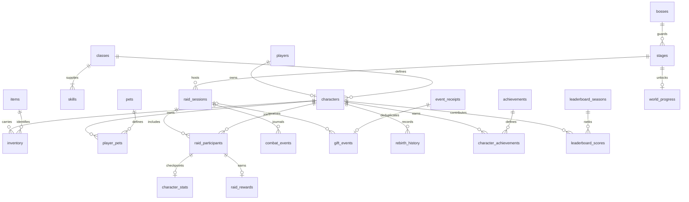

# Database design · RE:BIRTH

Status: relational design and executable scratch prototype for master prompt section 7.2. Runtime RC4 still uses schema v2 in [store.ts](../apps/server/store.ts): `players(id, profile JSON)`, `event_receipts(id, accepted_at)` and `world_progress(singleton, stage)`. No running database is changed by this document, SQL file or its tests. Adoption needs a future store adapter, importer and migration/recovery QA; Leader architecture review remains pending.

[normalized.sql](schema/normalized.sql) defines all 17 requested entities plus seven supporting tables. It is deliberately outside the runtime migration path and contains no `user_version` assignment. Validate it with `node --test tests/schema-design.test.ts`, which creates only in-memory databases. Do not execute this prototype against an existing save: its table names overlap schema v2.

Settings are database-wide; no foreign-key relationship is needed for their small whitelisted values. Optional actor/sender references and additional constraints are specified in the SQL and sections below.

## Storage contract

- One local SQLite database per mode; MOCK and LIVE remain separate. Player IDs retain their exact stable strings. Username/display name can change and are not unique keys. One current character per player matches RC4; multiple character slots are outside this design's enabled behavior.
- Integers represent counts, booleans (`0/1`) and Unix epoch milliseconds. The adapter must validate JS safe integers before writing. Known historical timestamps may be NULL; migration/import time is not a fabricated acquisition or creation time.
- `STRICT` tables, foreign keys enabled on every connection, prepared statements, WAL and a bounded busy timeout are required. Foreign keys use the default RESTRICT/NO ACTION behavior; deletion is an explicit offline leaf-to-parent procedure rather than an accidental cascade.
- Content catalogs come from the versioned game source, never a client or arbitrary SQL. Freeze their revision for a raid. `raid_sessions.initial_state_json` must contain the initial simulation state, resolved loadouts and a complete content/formula snapshot; `content_revision` identifies the source commit. Catalog updates wait until no raid is active. Historical replay must use the pinned snapshot/rules, not today's catalog values.
- A process starts with an empty active roster. Joining restores progress and resets transient combat fields. The normalized character record is durable identity/progression, not proof of session membership. An unfinished raid becomes `aborted` on cold start; it is not resumed from saved HP.

## Identity, content and possessions

The SQL file is authoritative for exact types, nullability and CHECK expressions. These columns describe their purpose and ownership.

| Required entity | Columns and keys | Relationship and invariant |
| --- | --- | --- |
| `players` | `player_id` PK; `source`; nullable `username`; `display_name`; nullable `imported_at`, `first_seen_at`, `last_seen_at` | Stable external/local ID. Normal display names have at most 32 characters; RC4's blank-name fallback can use the stable ID, up to 80. The target preserves that valid fallback without truncation. Imported profiles have unknown historical first/last-seen timestamps unless evidence exists. |
| `characters` | `character_id` PK; unique `player_id` FK; `class_id` FK; `level`, `xp`, `rebirth`, `wins`, `shards`, `spent_pet_shards`, `auto_enabled`, nullable `active_pet_id` | One character per player. Level ≥1, rebirth 0–5, nonnegative totals. Composite deferred FK `(character_id, active_pet_id)` requires the active pet to be owned by this character. |
| `classes` | `class_id` PK; `name`, `element`, `color`, `base_attack`, `base_defense`, `crit_every`, `content_revision` | Six catalog IDs match shared source. Critical cadence is stored; displayed probability is derived as 1/cadence. Derived equipment/pet/level attack is not duplicated here. |
| `skills` | composite PK/FK `class_id, slot`; `name`, `mana_cost`, `cooldown_ms`, `multiplier`, `effect_key` | Slots 0/1/2 mean skill I/II/ultimate; slot 3 is basic attack, matching `Player.ready`. Three class skills plus a basic definition per class. Effect keys dispatch trusted code rather than executable database expressions. |
| `inventory` | composite PK `character_id, item_id`; FKs to character and item/slot; `slot`, `equipped`, nullable `acquired_at` | Each current item is unique per character. A partial unique index allows one equipped item per slot. Composite item/slot FK prevents equipping a staff in the armor slot. No purchased or random monetary inventory. |
| `pets` | `pet_id` integer PK 0–2; `name`, `color`, `base_attack`, `skill_key`, `content_revision` | Preserve current zero-based Hỏa Hồ/Băng Vũ/Lôi Miêu IDs. Pet level bonuses and skill behavior derive from trusted code. |
| `player_pets` | composite PK `character_id, pet_id`; both FKs; `level`, nullable `unlocked_at` | Ownership belongs to the character even though the required historical entity name is player_pets. Level 1–5. Count of these rows replaces redundant `owned`. |

`items` is the supporting catalog: PK `item_id`, name, slot, attack, defense and required ranked wins. It provides both the item FK and the unique `(item_id, slot)` reference. Seed Ember/Aegis/Eclipse directly from shared source.

## Encounters and simulation

| Required entity | Columns and keys | Relationship and invariant |
| --- | --- | --- |
| `bosses` | `boss_id` PK; name; base HP, per-stage and per-extra-member HP; phase percentages; normal/enrage intervals; content revision | Varkhazar's current HP is `440 + 40×stage + 75×(starting_members−1)`; phase II ≤55%, enrage ≤25%. Actual combat powers and signatures remain in the pinned rule snapshot. |
| `stages` | integer `stage_id` PK ≥1; `boss_id` FK; `rule_key`; unique `(stage_id, boss_id)` | Insert content rows as stages are needed. Higher numerical stages reuse the current arena/boss rules; this does not enable P8 maps or multi-floor dungeons. |
| `raid_sessions` | `raid_id` PK; composite stage/boss FK; ranked/practice `mode`; mock/live `source`; rules/content revisions; start/end timestamps; status/phase; HP/max HP; starting-members count; next due/pause timestamps; initial JSON | At most one active raid per database. Snapshot starting members determine difficulty. Victory requires DEAD/0 HP/end time; defeat/abort requires RESET/end time. Active state has no end time. |
| `character_stats` | composite PK/FK `raid_id, character_id`; HP, MP, contribution, attack count, guard, last-hit time and four readiness timestamps | Transient per-raid checkpoint, owned by a participant. MP 0–60 and nonnegative counters. It is not an alternative durable profile and is reset for the next raid. Max HP, ATK and DEF derive from the pinned character/content snapshot. |
| `combat_events` | composite PK `raid_id, sequence`; `at`; nullable participant `actor_character_id`; typed `kind`; bounded `details_json` | Ordered simulation journal. Composite actor FK prevents an unrelated character being attributed to the raid. Boss/admin events have NULL actor. Details carry sanitized operations/outcomes, not raw LIVE packets or arbitrary chat text. |

Supporting tables:

- `raid_participants`: composite raid/character PK and FKs, join time and nullable final contribution. Final contribution is settled at outcome; zero contributors receive no ranked reward. Joining mid-fight with 0 HP preserves current spectating behavior; it does not change starting difficulty.
- `raid_rewards`: composite participant PK/FK, EXP/shard/score deltas and grant time. An INSERT trigger requires a contributing ranked victory. UPDATE is forbidden; the unique participant key guards repeated settlement. The application must insert the ledger row first and apply deltas only for that successful insertion, all in the same transaction.
- `world_progress`: singleton=1 and stage FK. It stores the highest unlocked next stage, including stage 1 when no victory is recorded. Import the number; do not invent earlier raid sessions to justify it.

Global IDLE means no active raid row. A session row begins at SPAWN. The initial-state object has a 256 KiB encoded UTF-8 cap; event detail objects have a 4 KiB cap and setting values an 8 KiB cap. SQL uses BLOB byte length rather than Unicode character count for these limits.

A trigger makes the raid ID, stage/boss, ranked/practice mode, source, pinned rules/content, initial snapshot, start time/member count and starting max HP immutable. A practice raid with applied gifts cannot later be relabeled ranked to receive rewards. Checkpoint updates use only phase/status/end time, current HP, next due and pause fields; they do not rewrite identity/configuration columns.

Pause adjusts the next due time, skill/basic readiness and live buffs together, as in RC4. Current support pet, awakening, ward, wraith HP and control-delay state live in the typed simulation journal/checkpoint JSON; exact validation must mirror `Raid`. SQL JSON validity alone is not that validation. During a live raid the adapter must also enforce HP ≤ computed maximum, participant limits, monotonic sequence/time and valid phase transitions; cross-row/formula rules are application invariants, not claimed SQLite CHECK guarantees.

## Progression and ranking

| Required entity | Columns and keys | Relationship and invariant |
| --- | --- | --- |
| `rebirth_history` | composite PK `character_id, cycle`; character FK; previous level/XP; actual event time | Cycle 1–5 and previous level ≥3. Write only observed future rebirths. A migrated character at rebirth 3 has a baseline count of 3; no three fictional history rows are inserted. |
| `achievements` | `achievement_id` PK; name, trusted rule key, content revision | Catalog of the six current badges. Badge conditions derive from real character/inventory/pet progress and do not alter stats or score. |
| `leaderboard_seasons` | `season_id` PK; all-time/season kind; active/closed status; nullable start/end times; rules version | Seed only the all-time board for RC4 semantics. One active board per kind. The schema can name a future seasonal board, but P8 season functionality is not enabled. |

Supporting tables:

- `character_achievements`: character/badge composite PK/FKs, nullable earned time and known observed time. Imported eligible badges have unknown earned time; recomputation observes them at import time.
- `leaderboard_scores`: season/character composite PK/FKs, nonnegative points and `baseline_points` between 0 and points. An index `(season_id, points DESC, character_id)` supports deterministic top-eight selection. Import current score unchanged into the all-time board, marking that entire value as baseline. Old v2 storage cannot prove its per-raid provenance; new reward rows do not manufacture that proof. Future seasonal policy needs Leader review.

The write adapter must enforce the current progression formulas: level-ups consume `level×100` EXP, rewards are `100+20×stage` EXP and one shard, pet upgrade cost to level L is `L×(L−1)/2` per pet, and rebirth caps at five. SQL checks prevent negative totals and invalid pet/slot ownership, while transaction code enforces these formulas, earned-item gates, history cycle progression and score updates. Tests of this SQL prototype do not claim to implement that adapter.

## Gifts, receipts and configuration

| Required entity | Columns and keys | Relationship and invariant |
| --- | --- | --- |
| `gift_events` | `event_id` PK/FK receipt; nullable raid FK; sender stable key and nullable known-player FK; provider gift ID; configured tier; complete=1; applied flag, decision and processing time | Only normalized completed streaks enter durable gift history. Incomplete updates remain connector state. A known player's FK must match sender key. An INSERT trigger permits applied effects only in active practice; a partial unique index limits each applied tier to once per raid. UPDATE is forbidden. |
| `settings` | whitelisted `key` PK; bounded JSON value; update time | Keys: render quality, gift map, rules version, database mode and import baseline. The adapter validates each value shape. Euler keys, cookies, passwords, tokens and credential-bearing connection URLs stay in local environment variables, never this table. |

`event_receipts` supports idempotency: event ID PK and processing timestamp. Keep the v2 ID and `accepted_at` value exactly; that legacy timestamp means processing/commit time, not HTTP acceptance time. Receipts do not require a player/raid FK because old receipts never stored those relationships. Automatic simulation steps have no fabricated viewer event or receipt.

Gift tier values 1/5/10/20/30 are configured effects, not a statement of the real price paid. Do not infer verified coin prices from them. The optional sender-player FK may be NULL for a non-joined donor; recording a gift must not auto-enroll a character. The write adapter additionally requires a living joined sender and the tier's actual eligibility conditions before applying an effect. Ranked gifts remain cosmetic; practice never writes progression rewards. No cash-out, paid random loot or monetary prize model is introduced.

For a normalized viewer event, receipt insertion, its decision row/journal entry and resulting state changes commit in one transaction. Receipt conflict means rollback/no mutation. For a rank victory, settlement, ledger insertion, character/score changes and stage unlock commit together. Auto batches use the same mutation transaction without a receipt. A persistence failure publishes no draft state and pauses operation. Never dual-write v2 and normalized databases with independent commits.

## Retention and access

SQLite files, backups, checkpoints and reports containing stable IDs/names stay local and private. Publish only synthetic fixtures and schema/source. No schema field is needed for a TikTok session secret. Logs expose filtered errors, not SQL parameters or raw provider frames.

Keep durable progression, cumulative baseline, reward ledger and actual rebirth history. Prune gift decisions and event receipts together after the existing 24-hour duplicate window: delete expired gift children first, then unreferenced expired receipts. A repeated event outside that window remains outside the promised idempotency horizon, matching RC4. Bound combat journal retention to a documented operator policy (proposed seven days or 100,000 events, whichever is reached first); retain final outcome/reward summaries. An initial snapshot is a finite per-raid object with the 64-player limit. Apply byte limits before serialization; never allow an unbounded journal/blob. Retention needs implementation and load verification before adoption.

Use role-free local access as in RC4: loopback server and host/origin checks, with no public SQL endpoint. A user deletion operation, if added, must explicitly remove leaf history/score/possession rows and identities in a single offline transaction and expire associated private backups per the operator's policy. No automatic profile deletion or new sharing is enabled by the design.

## Migration mapping from schema v2

| v2 source | Target and rule |
| --- | --- |
| `players.id`, `profile.id` | Must match. Preserve exactly as `players.player_id`, `characters.character_id` and character's player FK. Determine MOCK/LIVE from the selected database's mode; do not rename IDs or infer identity from names. |
| `name`, optional `username` | Display name and nullable username. Validate current normalization limits; preserve duplicate/changing names. Imported-at is known now; historical first/last-seen remain NULL. |
| `classId`, `level`, `xp`, `rebirth`, `wins`, `shards` | Character columns, without rebalance or synthetic historical rows. Reject unknown catalog IDs or unsafe/invalid counts instead of silently coercing them. |
| `score` | All-time leaderboard points and equal baseline_points; no historical raid/reward rows. |
| `auto` | `auto_enabled`; absent is false. Leave/roster state is not imported. |
| `spentPetShards` | `spent_pet_shards`; absent is zero. Validate spent total against available upgrade shards and owned pet levels. |
| `owned`, `petLevels` | Rows for the first `owned` zero-based pet IDs, preserving each existing level or defaulting an absent level to 1. Do not create extra unlocks. Validate 0–3 owned and 1–5 levels. |
| `pet` | Nullable active_pet_id after ownership rows exist; reject non-owned selection. |
| `inventory`, `equipment` | One row per owned known item; absent inventory is empty. Equipped flags derive from owned item/slot mappings. Reject non-owned equipment, wrong slot or contradictory duplicate ownership rather than silently unequipping/granting items. Acquisition times remain NULL. |
| HP/MP, ready, contribution, lastHit, attackCount, guard | Transient fields remain in the private source backup, but do not populate a resumed raid or durable current stats. New join/start resets them as RC4 does. |
| Derived ATK/DEF/maxHP/critical cadence/element | Recompute from the same pinned catalog/formula revision used at cutover; no duplicate imported stat totals. Preserve source character/gear/pet inputs. |
| Derived achievements | Evaluate the existing trusted badge predicates from imported progress; earned_at NULL and observed_at=import time. |
| `event_receipts.id`, `accepted_at` | Copy byte-for-byte ID and integer timestamp. No sender/gift/raid/history relationship can be recovered from these two fields. |
| `world_progress.stage` | Create necessary stage catalog references and singleton target number. Do not create invented cleared-raid history. |
| Current content in TypeScript | Seed six classes, 24 skill/basic rows, three pets, three items, boss rule and six badge definitions from the pinned source revision. Record source/schema/content hashes in the import manifest. |

There is no source history for individual raids, completed gifts, rebirth timestamps, badge earning times or item/pet acquisition dates. Their target histories start empty except currently derived badge observations. Unknown history stays unknown. The design must not claim historical LIVE verification from aggregate receipts or scores.

## Proposed cutover procedure and rollback

1. Ship an explicit future adapter/importer release only after schema and migration review. RC4's store accepts only versions 0/1/2 and is not compatible with this target. A proposed next `user_version` must be assigned with that release, not by this prototype.
2. Stop ingress using graceful shutdown and wait for accepted events and database close. Create an Online Backup into a new private file; preserve the original save. Hash source and backup, and record source schema version, counts, mode and content revision. For v1, upgrade a separate snapshot through the existing v1→v2 path first; its default stage 1 reflects missing old history.
3. Create a new destination path. Load catalogs and the prototype's reviewed successor schema. Use one import transaction, foreign keys enabled before BEGIN, and the deferred owned-pet relationship. Map profiles/receipts/stage as above; record known migration facts under import-baseline. Abort on malformed JSON, identity mismatch, unknown IDs, impossible progression, FK or uniqueness failures. Keep an error count and safe reason, never leak the actual private row into public QA output.
4. Validate complete source/target profile counts, every source durable field, leaderboard ordering/ties, pet levels/selection, gear, shard spending, auto preference, all receipt IDs/times and stage. Check foreign_key_check and quick_check. Compare canonical reconstructed Player durable snapshots, not reset transient fields. Verify empty historical tables and NULL unknown dates; no fabricated rewards or new score.
5. Commit the target schema version only with successful import/validation. Reopen with the new adapter and run synthetic join/start/pause/recovery, duplicate receipt, rank and auto-win checks against a copied test target. Fault-inject failures before/within import and before pointer switch; require rollback/no partial publication. A migration twice must either verify the same completed manifest or refuse, never duplicate rewards.
6. Select the new path and matching new application only after those gates pass, keeping ingress stopped until then. Do not point RC4 at it. Roll back by stopping the new process and restoring the original version+v2 snapshot into a new path; reverse-converting an unverified target is not the rollback method. New progress after cutover must be reconciled explicitly before rollback, rather than silently discarding it.

Importer, future adapter, failure injection, production migration and normalized-store endurance are not implemented or accepted by this design. The existing v1→v2 migration and runtime transaction/backup tests remain the currently deployed evidence. This fulfills the detailed design deliverable; runtime adoption remains a separately gated architecture task.
